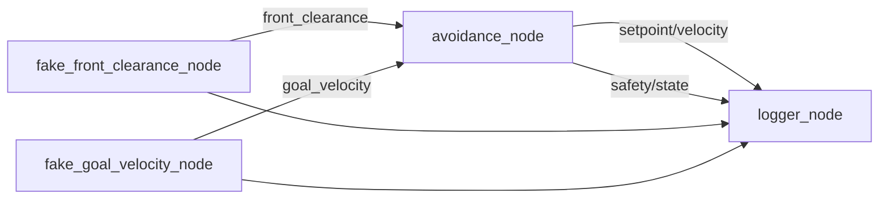

# Demo architecture and topic contracts

One Python package, `zefiro_demo`, contains four nodes. `avoidance_core.py` makes the numerical decision without ROS. `avoidance_node.py` handles messages, timers, and input freshness.



## Topics

| Topic | Type | Producer → consumers | Contract |
| --- | --- | --- | --- |
| `/zefiro/perception/front_clearance` | `std_msgs/msg/Float32` | Synthetic sensor → avoidance, logger | Metres; negative, NaN, or infinite values invalid; 10 Hz in the demo |
| `/zefiro/mission/goal_velocity` | `geometry_msgs/msg/TwistStamped` | Synthetic mission → avoidance, logger | m/s; frame exactly `base_link`; finite x ≥ 0; other five components zero; 20 Hz |
| `/zefiro/setpoint/velocity` | `geometry_msgs/msg/TwistStamped` | Avoidance → logger | Filtered x, other components zero; `base_link`; fresh publication stamp; 20 Hz default |
| `/zefiro/safety/state` | `std_msgs/msg/String` | Avoidance → logger | Decision state, published each control cycle |

QoS is reliable and volatile. Avoidance retains one incoming sample; the synthetic sources and logger use depth 10. A future best-effort sensor driver will need an explicit QoS compatibility check.

## Decision order

1. Missing, stale, or invalid sensor age → `SENSOR_TIMEOUT`, zero.
2. Negative or non-finite distance → `INVALID_INPUT`, zero.
3. Missing, stale, or invalid goal age → `GOAL_TIMEOUT`, zero.
4. Negative/non-finite goal, wrong frame, or nonzero extra axes → `INVALID_INPUT`, zero.
5. Distance ≤ stop threshold → `STOP`, zero.
6. Between stop and slowdown thresholds → `SLOWDOWN`, linearly scaled speed.
7. Distance ≥ slowdown threshold → `CLEAR`, bounded requested speed.

The requested speed is limited **before** slowdown:

```text
limited = min(goal_vx, max_velocity_mps)
scale = (clearance - stop_distance_m) / (slowdown_distance_m - stop_distance_m)
cmd_vx = limited * scale
```

With defaults, 5 m / goal 1 → 1 m/s; 2 m / goal 1 → 0.5 m/s; 2 m / goal 100 → 0.75 m/s; 0.7 m → 0 m/s. The command never becomes negative.

## Start-up parameters

Set in `src/zefiro_demo/config/demo.yaml` relative to `zefiro_autonomy/`.

| Parameter | Default | Constraint |
| --- | --- | --- |
| `stop_distance_m` | 1.0 | ≥ 0 and below slowdown |
| `slowdown_distance_m` | 3.0 | Above stop |
| `sensor_timeout_s` | 0.5 | Positive |
| `goal_timeout_s` | 0.5 | Positive |
| `max_velocity_mps` | 1.5 | Positive |
| `control_rate_hz` | 20.0 | Positive |

All values must be finite; write YAML values as decimals. Invalid configuration prevents startup. Avoidance parameters are read-only after startup: edit YAML and relaunch.

Watchdogs use local monotonic arrival time and a steady timer, so they run even when simulated ROS time stops. A timeout occurs after 0.5 s; the next control tick adds nominally up to 0.05 s plus scheduling delay. This is not a real-time guarantee.

## Limits

- This is a one-dimensional demo with no geometric perception, braking model, acceleration limit, or drone dynamics.
- Arrival-time freshness does not detect old samples queued upstream, duplicates, or false source timestamps. `Float32` has no timestamp.
- No external watchdog handles a crash of avoidance. A future receiver must reject stale setpoints; task P4 addresses this.
- Velocity and state are separate topics. Logger output combines the latest samples; it is not an atomic snapshot.
- The `base_link` body frame is not transformed to world or PX4 frames.
- There is no PX4, Gazebo, camera driver, or hardware command in the current demo.

Split the package only after the group has tried the interfaces, keeping the reference demo runnable.
