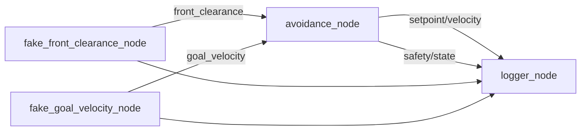

# Architettura e contratti della demo

Un pacchetto Python, `zefiro_demo`, con quattro nodi. La logica numerica è in `avoidance_core.py`; `avoidance_node.py` gestisce messaggi, timer e freschezza degli input.



## Topic

Tutti i nomi iniziano con `/zefiro/`.

| Nome completo | Tipo | Produttore → consumatori | Contratto |
| --- | --- | --- | --- |
| `/zefiro/perception/front_clearance` | `std_msgs/msg/Float32` | sensore finto → avoidance, logger | Metri; negativo, NaN e infinito invalidi; 10 Hz nella demo |
| `/zefiro/mission/goal_velocity` | `geometry_msgs/msg/TwistStamped` | missione finta → avoidance, logger | m/s; frame esattamente `base_link`; x ≥ 0 finito; altri cinque componenti zero; 20 Hz |
| `/zefiro/setpoint/velocity` | `geometry_msgs/msg/TwistStamped` | avoidance → logger | x filtrato; altri componenti zero; frame `base_link`; stamp al momento della pubblicazione; 20 Hz di default |
| `/zefiro/safety/state` | `std_msgs/msg/String` | avoidance → logger | Stato della decisione, pubblicato a ogni controllo |

QoS attuale: reliable, volatile; avoidance mantiene solo l'ultimo campione in coda (depth 1). Le sorgenti finte e il logger usano depth 10. Un futuro driver sensore best-effort richiederà una scelta QoS esplicita e test di compatibilità.

## Decisione: ordine dei controlli

1. Sensore mai ricevuto, troppo vecchio o età invalida → `SENSOR_TIMEOUT`, zero.
2. Distanza negativa/non finita → `INVALID_INPUT`, zero.
3. Goal mai ricevuto, troppo vecchio o età invalida → `GOAL_TIMEOUT`, zero.
4. Goal negativo/non finito, frame diverso o altri assi non zero → `INVALID_INPUT`, zero.
5. Distanza ≤ stop → `STOP`, zero.
6. Tra stop e slowdown → `SLOWDOWN`, velocità ridotta linearmente.
7. Distanza ≥ slowdown → `CLEAR`, velocità richiesta limitata.

La saturazione viene applicata **prima** del rallentamento:

```text
limited = min(goal_vx, max_velocity_mps)
scale = (clearance - stop_distance_m) / (slowdown_distance_m - stop_distance_m)
cmd_vx = limited * scale
```

Esempi con default: 5 m / goal 1 → 1; 2 m / goal 1 → 0.5; 2 m / goal 100 → 0.75; 0.7 m → 0. Il comando non diventa negativo.

## Parametri di avvio

File: `src/zefiro_demo/config/demo.yaml` (relativo a `zefiro_autonomy/`).

| Parametro | Default | Vincolo |
| --- | --- | --- |
| `stop_distance_m` | 1.0 | ≥ 0 e minore di slowdown |
| `slowdown_distance_m` | 3.0 | maggiore di stop |
| `sensor_timeout_s` | 0.5 | positivo |
| `goal_timeout_s` | 0.5 | positivo |
| `max_velocity_mps` | 1.5 | positivo |
| `control_rate_hz` | 20.0 | positivo |

Tutti devono essere finiti e nel YAML vanno scritti come numeri decimali. Parametri invalidi impediscono l'avvio; quelli di avoidance sono read-only durante l'esecuzione. Modificare il YAML e rilanciare.

I watchdog usano il tempo monotono locale di ricezione e un timer steady: continuano anche se `use_sim_time` è fermo. Il timeout scatta quando l'età supera 0.5 s; il successivo ciclo di controllo aggiunge nominalmente fino a 0.05 s, oltre al ritardo dello scheduler. Non è una garanzia real-time.

## Limiti espliciti

- È una demo 1D, senza percezione geometrica, frenata dinamica, accelerazione limitata o modello del drone.
- La freschezza è misurata dall'arrivo locale: non rileva dati vecchi già accumulati a monte, duplicati o timestamp sorgente falsi. `Float32` non porta timestamp.
- Nessun watchdog esterno controlla il crash di avoidance: un futuro ricevitore deve scartare setpoint scaduti. Il task P4 prepara questa responsabilità.
- Stato e velocità viaggiano su due topic separati, senza sincronizzazione atomica. Il logger mostra gli ultimi dati ricevuti.
- Il frame body `base_link` non viene trasformato verso frame mondo/PX4.
- Non sono presenti PX4, Gazebo, driver camera o comandi hardware.

La divisione futura in pacchetti va fatta quando le interfacce sono state provate dal gruppo, mantenendo runnable la demo di riferimento.
